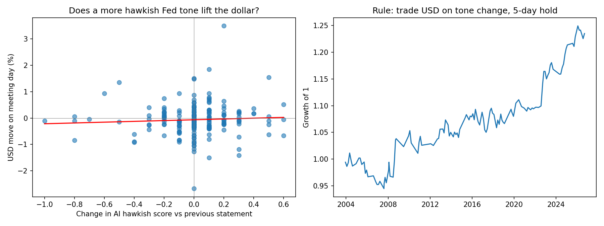

# Fed Statement Tone -> USD Signal (LLM-scored)

**Question:** Can an LLM reading FOMC statements produce a hawkish/dovish score that predicts USD moves?

**Short answer:** Tone changes had a consistently positive but statistically insignificant relationship with EUR/USD moves. The signal is too weak to trade on its own.

## Method
1. **Data:** all 226 FOMC policy statements (Feb 2000 - Sep 2026, public Fed text) and daily EUR/USD prices (Yahoo Finance, Dec 2003 onward).
2. **Scoring:** an LLM (Google Gemini Flash-Lite via the free API tier, `gemini-flash-lite-latest`, run September 2026) rates each statement from -1 (dovish) to +1 (hawkish) at temperature 0, and is told to judge only from the text.
3. **Signal:** the *change* in score vs the previous statement (markets react to shifts in tone, not levels).
4. **Tests:**
   - (a) correlation of score change with the same-day USD move,
   - (b) correlation with the USD move over the next 5 trading days,
   - (c) a simple rule: long USD after a more hawkish tone, short USD after a more dovish tone, 5-day hold.

## Results
- Meetings analysed: 190 (Dec 2003 - Sep 2026), EUR/USD
- Same-day reaction: r = +0.06 (p = 0.42), Spearman +0.10 (p = 0.16), direction hit-rate 54.4%
- Next-5-day drift: r = +0.10 (p = 0.17), Spearman +0.07 (p = 0.34), direction hit-rate 53.6%
- Simple rule: 125 trades, avg +0.18% per trade, win rate 53.6%, approx. Sharpe 0.33, t-stat 1.58 (p = 0.12), +23.5% cumulative over 22.8 years (before transaction costs)



## Memo (what a PM needs to know)
- **Finding:** Tone changes had a consistently positive but statistically insignificant relationship with USD moves. The simple trading rule was profitable on paper but not distinguishable from luck at the 5% level, and a large share of its gains came from the 2022+ hiking cycle.
- **What worked:** The LLM scores were sensible on spot checks (hikes scored positive, near-zero-rate statements scored negative), and every measured relationship had the theoretically expected sign.
- **What didn't:** The effect is too small to trade on its own. Markets appear to price in most of the Fed's tone before the statement is released, so same-day moves are mostly noise.
- **Limitations (read these):**
  - *Look-ahead bias:* the LLM was trained on data that includes what happened after each statement, so it may "know" outcomes. The prompt forbids this but cannot guarantee it. A stricter test would use only statements published after the model's training cutoff.
  - One currency pair (EUR/USD) and one central bank (the Fed); 190 events, so results are statistically noisy.
  - Same-day returns include moves before the 2pm ET release; only the 5-day drift is tradable.
  - No transaction costs or bid-ask spreads.
  - Trades are only made when the score changes (125 of 190 meetings).
- **Next steps:** add ECB/BoE/BoJ statements and more currency pairs, test the score as a filter on an FX carry strategy, and compare against a simple word-count baseline.

## Run it
```
pip3 install -r requirements.txt
export GEMINI_API_KEY="your-key"
mkdir -p data results
python3 step1_get_data.py
python3 step2_score_free.py
python3 step3_analyze.py
```
Free Gemini API key: aistudio.google.com (no credit card needed).
